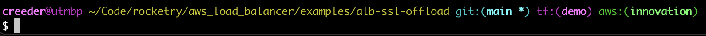

Over the years of working with OpenTofu, Terraform, and the AWS CLI, I've tried to optimize my tooling and developer experience. Since I am a consultant and use AWS CLI and OpenTofu or Terraform on a daily basis, it's important to me that I have low friction between me and the work I need to perform. I often work with several different environments and clients in a given day.

The following is a collection of tools and practices that help me reduce that friction. Some are existing tools I've adopted, others are scripts and aliases I've built to eliminate repetitive tasks. Each one is simple on its own, but together they save me hours every week.

Some quick technical notes:
- **Focus**: This article covers OpenTofu and Terraform primarily, AWS secondarily. Most recommendations are cloud-neutral, though one is AWS-specific.
- **Platform**: I develop on macOS. All suggestions should work on Windows, though some may require translation to PowerShell, Git Bash, or WSL.

None of these tools are complex or groundbreaking, but they show a habit worth building: when you encounter the same problem repeatedly, invest time to automate it. Use these suggestions as inspiration to build your own toolbox.

## 1. Easily swap between OpenTofu/Terraform versions

[tenv](https://github.com/tofuutils/tenv) is the most useful helper application in my toolbox. A natural successor to tfenv, this version helper supports OpenTofu, Terraform, Terragrunt, Terramate, and Atmos.

This eliminates the need to manually install or swap versions. In each root module, define an `.opentofu-version` or `.terraform-version` file with a valid HCL version constraint, and that version will be used every time!

Generally, my `.opentofu-version` file contains `latest-allowed`, which selects the newest release that satisfies the `required_version` in my `terraform` block. I specify a major and minor version there, like this:

```hcl
terraform {
  required_version = "~> 1.11.0" # OpenTofu
}
```

If you use the `tf` command that `tenv` installs, the version file is required to select the proper tool (OpenTofu or Terraform) and version for your projects.

## 2. Summarize OpenTofu/Terraform plans with grep

A simple `grep` gives you a surprisingly good summary of a plan.

> [!IMPORTANT]
> This is not a replacement for reviewing a full plan, but is good for a spot check.

Plan output marks each resource action with a line containing "will be" or "must be". When dealing with a larger plan, it's useful to sometimes break this down into a summary.

`grep -E "(will|must) be|Plan:|No changes|Changes to Outputs|Error:"`

This matches those resource lines, plus the plan totals, the "No changes" message, output-only changes, and errors. That way a clean plan or a failed plan still prints something.

Put it in an alias to make it easy to use when needed. Add the following to your `.bashrc` or `.zshrc`:
```bash
alias tfsum='tf plan | grep -E "(will|must) be|Plan:|No changes|Changes to Outputs|Error:"'
```

You can see an example of the output in this image:

![Output of the tfsum alias: one line per resource action, such as "# terraform_data.web[2] will be created", followed by the line "Plan: 2 to add, 2 to change, 2 to destroy."](tfsum.png)

## 3. Lint your code for common errors or bad practices
As of October 2026, the standard linting tool for both OpenTofu and Terraform is [tflint](https://github.com/terraform-linters/tflint). In the future there may be a need for separate tools, as some newer OpenTofu-specific features may trigger errors in tflint.

While tflint provides a solid foundation, enabling additional plugins significantly enhances its capabilities, so make sure you enable the plugin for your relevant cloud platform.

To do that, you'll need to set some additional configuration in your home folder. You can also change the configuration to disable any rules that don't match your organization's standards.

What I recommend is to enable all rules and tune from there. The below example includes the AWS plugin, but you can remove or swap that.

Create a file named `.tflint.hcl` in your home folder, and run `tflint --init`:
```hcl
config {
  call_module_type = "all" # Inspect child modules, as well
}

# See Terraform Ruleset here:
# https://github.com/terraform-linters/tflint-ruleset-terraform/tree/main/docs/rules/
plugin "terraform" {
  enabled = true
  preset  = "all"
}

# See AWS Ruleset here:
# https://github.com/terraform-linters/tflint-ruleset-aws/tree/master/docs/rules
plugin "aws" {
  enabled = true
  version = "0.49.0" # This version should be updated periodically
  source  = "github.com/terraform-linters/tflint-ruleset-aws"
}
```

> [!NOTE]
> You can also have custom `.tflint.hcl` files in projects or modules that you want custom configuration for. I recommend configuring this strict default in your home folder, and perhaps more lenient rules in a project if needed.

## 4. Speed up AWS profile switching
This one is AWS-specific, but it's my favorite and the one I use the most as a consultant. When you need to work on multiple AWS environments or accounts, you will find yourself switching profiles on the AWS CLI often (or passing a profile flag to every command).

Thankfully, the AWS SDK and CLI support profile selection through an environment variable. As a result, I created a tool called [awsp](https://github.com/abyss/go-awsp), which parses the AWS CLI config and exports an environment variable based on an interactive selection (`AWS_PROFILE`).

The tool needs some extra setup, which is covered in the [source repository](https://github.com/abyss/go-awsp). Follow the steps there, and skim the code first, as you would with any tool that runs in your shell. Once it is set up, run `awsp` to get a selection of AWS profiles.

## 5. Show your Git branch, OpenTofu/Terraform workspace, and AWS profile in your prompt

This requires a bit of customization and work depending on your environment setup, but the improvement is worth the effort.

See the following example of my prompt in `bash`:



If you are using Zsh and Oh My Zsh, similar functionality is available through usage of the [`git`, `terraform`, and `aws` plugins](https://github.com/ohmyzsh/ohmyzsh/wiki/Plugins). This is the quick and easy route.

If you are using Bash, you may need to build your own. Some pointers:

- You can get your AWS profile from the `AWS_PROFILE` environment variable. See my [aws-prompt.sh](https://github.com/abyss/dotfiles/blob/main/bin/aws-prompt.sh).

- You can get Git details from a helper script, thankfully included with the git project itself: See [git-prompt.sh](https://github.com/git/git/blob/master/contrib/completion/git-prompt.sh). This one has lots of useful configuration options to show more than just the current branch.

- You can see the current OpenTofu/Terraform workspace by just looking at what's in `.terraform/environment`, if it exists. See [terraform-prompt.sh](https://github.com/abyss/dotfiles/blob/main/bin/terraform-prompt.sh).

- You can combine all the above together into a script which you source in your `.bashrc`: See [set-prompt.sh](https://github.com/abyss/dotfiles/blob/main/bin/set-prompt.sh).

## Bonus suggestion: automate bulk operations with Task

> [!TIP]
> I took my own advice and created [wand](https://github.com/abyss/tfwand), a toolkit for OpenTofu/Terraform. Its plan feature does what the `plan-summary` task below does: it runs `tf init` and `tf plan` across many directories and prints one plan summary. Run `wand plan all` for every directory with `.tf` files, or `wand plan git` for only the directories with uncommitted changes. You can skip directories with `--exclude`, and a directory whose plan fails is reported with its errors instead of stopping the rest. Installation instructions and additional features are in the repository.
>
> The examples in this section are left here to inspire and encourage you to build your own tooling.

When you manage multiple OpenTofu/Terraform projects or work on monorepos with dozens of root modules, running the same commands across all of them becomes tedious. [Task](https://taskfile.dev/) (sometimes called "go-task") provides a simple, cross-platform way to define and run tasks. It is a modern alternative to [Make](https://www.gnu.org/software/make/manual/make.html), with better syntax and built-in features.

Unlike shell scripts, Taskfiles are declarative definition files for Task that support features like dependency management, variable interpolation, and dry-run modes out of the box.

### Simple examples

Here's a basic Taskfile that wraps common Terraform operations:

```yaml
version: "3"

tasks:
  fmt:
    desc: "Format all Terraform files"
    cmds:
      - tf fmt -recursive

  lint:
    desc: "Run tflint on the current module"
    cmds:
      - tflint --init
      - tflint
```

Run `task fmt` to format your code, or `task --list` to see all available tasks.

### Advanced example: bulk plan summary

When working with multiple modules, I often need to know which ones have pending changes. Here's a task that runs `tf plan` across all modules and provides a consolidated summary. Run it from a directory of root modules, since it runs `tf init` and `tf plan` in every directory that contains `.tf` files:

```yaml
version: "3"
set: [e, u, pipefail]

tasks:
  plan-summary:
    desc: "Run tf plan on all modules and summarize directories with changes"
    dir: '{{.USER_WORKING_DIR}}'
    cmds:
      - |
        echo "Finding Tf projects..."
        TF_DIRS=$(find . -type d -path '*/.terraform' -prune -o -type f -name '*.tf' -exec dirname {} \; | sort -u)

        if [ -z "$TF_DIRS" ]; then
          echo "❌ No matching directories found."
          exit 0
        fi

        CHANGED_DIRS=()
        ROOT_DIR=$(pwd)

        for dir in $TF_DIRS; do
          if ! cd "$dir"; then
            echo "Failed to cd into $dir"
            exit 1
          fi
          if ! tf init -input=false -no-color >/dev/null; then
            echo "❌ tf init failed in $dir"
            exit 1
          fi

          PLAN_OUTPUT=$(tf plan -input=false -no-color 2>&1)
          PLAN_EXIT=$?

          SUMMARY_LINE=$(echo "$PLAN_OUTPUT" | grep -E '^Plan: [0-9]+ to add, [0-9]+ to change, [0-9]+ to destroy\.' || true)
          OUTPUT_CHANGE=$(echo "$PLAN_OUTPUT" | grep -i -E '^\s*Changes to outputs:' || true)

          HAS_CHANGES=false
          HAS_OUTPUT_CHANGES=false

          if [ -n "$SUMMARY_LINE" ] && echo "$SUMMARY_LINE" | grep -qv 'Plan: 0 to add, 0 to change, 0 to destroy\.'; then
            HAS_CHANGES=true
          elif [ -n "$OUTPUT_CHANGE" ]; then
            HAS_OUTPUT_CHANGES=true
          fi

          if [ "$HAS_CHANGES" = true ]; then
            echo "$dir: 🚨 ${SUMMARY_LINE:-Changes detected}"
            CHANGED_DIRS+=("$dir")
          elif [ "$HAS_OUTPUT_CHANGES" = true ]; then
            echo "$dir: ⚠️ Output-only change detected"
            CHANGED_DIRS+=("$dir (outputs only)")
          else
            echo "$dir: ✅ No changes"
          fi

          cd "$ROOT_DIR" || exit 1
        done

        echo ""
        echo "========== Summary =========="
        if [ ${#CHANGED_DIRS[@]} -eq 0 ]; then
          echo "✅ No changes in any module"
        else
          echo "🚨 Changes detected in:"
          for d in "${CHANGED_DIRS[@]}"; do
            echo " - $d"
          done
        fi
    silent: true
```

Running `task plan-summary` gives you output like:

```text
./environments/dev: ✅ No changes
./environments/staging: 🚨 Plan: 2 to add, 1 to change, 0 to destroy.
./environments/prod: ⚠️ Output-only change detected

========== Summary ==========
🚨 Changes detected in:
 - ./environments/staging
 - ./environments/prod (outputs only)
```

This saves enormous amounts of time when reviewing changes across multiple environments or when preparing for a deployment.

## Closing thoughts: build your own toolbox

The specific tools matter less than the habit. Each time you encounter the same problem or pattern, ask whether a shell alias, function, script, or tool could solve it permanently. The `tfsum` alias took minutes to create but saves time on every large plan review. The Taskfile `plan-summary` took an hour to build but now checks dozens of modules in seconds.

Your toolkit will evolve differently based on your workflow. Each suggestion here targets a specific source of friction: juggling versions, wading through long plans, switching accounts, losing track of context, repeating commands across modules. Look for the same kind of friction in your own day. A few signs to watch for:

- A command you type several times a day is a candidate for an alias.
- A sequence of commands you always run together is a candidate for a shell function or script.
- Information you keep looking up, like your current branch, workspace, or account, is a candidate for your prompt.
- Work you repeat across many directories is a candidate for a small application, a script, or even something as simple as a Taskfile.

Check whether a tool already solves the problem before you build one, as with `tenv`, `tflint`, and Task. If nothing fits, write it yourself. Keep your aliases and scripts in a dotfiles repository so they follow you to every machine, and put shared tasks in the project's repository so your team gets them too.

I hope these suggestions gave you some new ideas or inspiration to improve your own experience.
